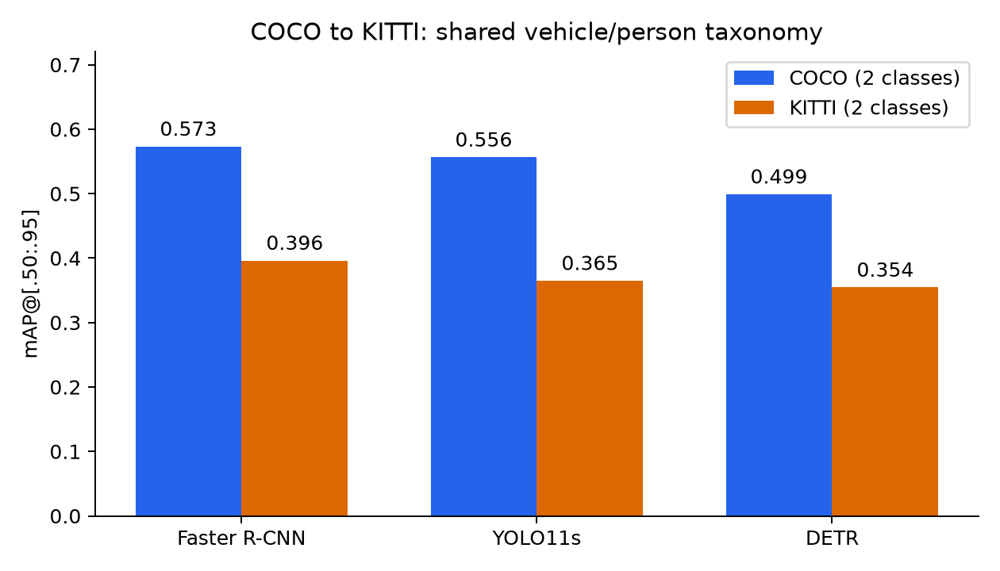
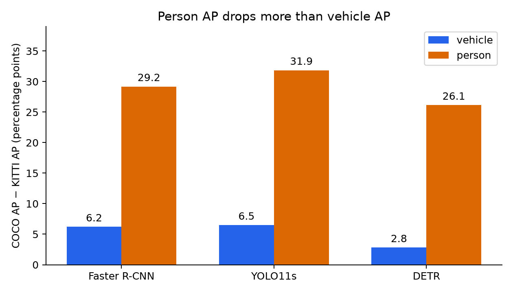
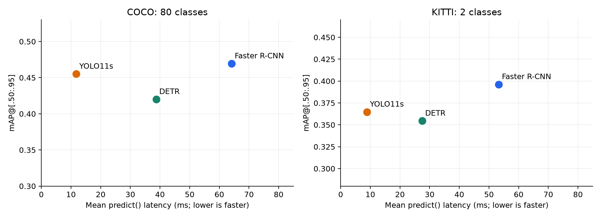

# 2D Object Detection: COCO to KITTI

Track A experimental evaluation of three COCO-pretrained detectors from three families,
without retraining. The two primary analyses are cross-dataset generalization and the
speed–accuracy tradeoff. The implementation follows the detector/dataset/evaluator
separation in the [course tutorial](https://github.com/lkk688/DeepDataMiningLearning/blob/main/DeepDataMiningLearning/ngdet/TUTORIAL.md).

Submission artifacts: [nine-page technical report](submission/technical_report.pdf)
and [experiment code/results archive](submission/experiment_code_and_results.zip).
The PDF includes a dedicated quantitative failure analysis, AI-use disclosure, and
12 references (six original research papers and five official framework/repository sources).


## Main findings

Faster R-CNN has the highest overall AP on native COCO and on KITTI under the shared
taxonomy. YOLO11s provides 5.44× its COCO FPS while losing 1.43 AP percentage
points; on KITTI it provides 6.02× its FPS. DETR lies between them in latency and
allocated GPU memory, but has lower overall AP in these configurations.

All models lose AP on KITTI under a matched vehicle/person taxonomy. Person AP drops
much more than vehicle AP. This is evidence of weaker transfer to the driving dataset
under this protocol; dataset composition and annotation differences also contribute.

## Models and inference settings

| CLI name | Family / checkpoint | Input resizing | Confidence | NMS IoU | Maximum outputs |
| --- | --- | --- | --- | --- | --- |
| frcnn | Two-stage CNN; fasterrcnn_resnet50_fpn_v2, COCO_V1 | Short side 800, long side ≤1333 | 0.001 | 0.5 | 100 |
| yolo11s | One-stage CNN; yolo11s.pt | imgsz=640, aspect-preserving letterbox; actual rectangle depends on image shape | 0.001 | 0.7 | 100 |
| detr | Transformer; facebook/detr-resnet-50 | Processor default: short side 800, long side ≤1333 | 0.001 | None | 100 queries |

Faster R-CNN uses region proposals followed by box classification/refinement; YOLO11s
uses a one-stage prediction pipeline. DETR treats detection as set prediction with
learned queries and bipartite matching during pretraining, avoiding NMS. See the
[torchvision model documentation](https://docs.pytorch.org/vision/main/models/generated/torchvision.models.detection.fasterrcnn_resnet50_fpn_v2.html),
[YOLO11 documentation](https://docs.ultralytics.com/models/yolo11/) and
[DETR paper](https://arxiv.org/abs/2005.12872).

These are comparisons of deployed configurations. Input resolutions, parameter counts,
training recipes and backend implementations differ, so the results do not isolate
architecture alone. Low confidence thresholds retain detections for ranking in AP;
family-specific NMS defaults remain explicit. No fine-tuning or accelerator export was used.

## Datasets and taxonomy

| Evaluation | Images | Split | Classes |
| --- | --- | --- | --- |
| COCO-80 | 5,000 | COCO val2017 | Native 80 classes |
| COCO-2 | 5,000 | Same COCO val2017 images | vehicle / person |
| KITTI-2 | 7,481 | All labeled KITTI object-detection training images | vehicle / person |

KITTI's labeled training split is used exclusively for evaluation: no weights are
trained or selected on it, and the unlabeled test set is unused. Every model sees
the same sorted image IDs per dataset. Images without target objects remain included.

| Shared class | COCO ground truth and detector names | KITTI ground truth |
| --- | --- | --- |
| vehicle | car, truck, bus, train | Car, Van, Truck, Tram |
| person | person | Pedestrian, Person_sitting |

The same mapping is applied to ground truth and predictions. Other COCO classes and
their predictions are excluded from the two-class task. Native COCO-80 scores are
reported separately and are never subtracted from two-class KITTI AP.

KITTI has 33,261 mapped vehicles and 4,709 mapped persons. Cyclist (1,627), Misc (973),
and DontCare (11,295) boxes are represented as COCO crowd-ignore regions for both
classes. At each COCO overlap threshold, matching prioritizes real target objects;
remaining detections that match an ignore region are excluded using
intersection/detection-area. Regions are not deleted and then treated as background.
Boxes are clipped to image bounds and converted from xyxy to xywh without a +1 pixel
adjustment. All target objects are retained without KITTI difficulty filtering.

This is a custom **COCO-style KITTI evaluation**, not official KITTI AP_R40 or its
easy/moderate/hard scores. In particular, duplicating excluded-object regions for both
classes can suppress predictions overlapping those regions; this is an approximation
whose effect was not separately measured. COCO person/bicycle boxes do not directly
represent KITTI's combined Cyclist object. The shared taxonomy improves comparability
without making the two annotation schemes identical. See the
[KITTI evaluation specification](https://www.cvlibs.net/datasets/kitti/eval_object.php?obj_benchmark=2d)
and the [COCO evaluator implementation](https://github.com/cocodataset/cocoapi/blob/master/PythonAPI/pycocotools/cocoeval.py).

## Accuracy results

All AP/AR values are fractions in [0,1]. AP averages IoU thresholds .50:.05:.95;
AP50 and AP75 fix the overlap threshold. AR1/10/100 cap detections per category per
image. COCO small/medium/large use annotation-area thresholds 32² and 96² pixels.
COCO retains its supplied areas (normally segmentation area); KITTI uses bounding-box
area, which is another limitation for scale comparisons.

### COCO-80

| Model | AP | AP50 | AP75 | AP small | AP medium | AP large |
| --- | --- | --- | --- | --- | --- | --- |
| Faster R-CNN | 0.4694 | 0.6790 | 0.5136 | 0.3095 | 0.5075 | 0.6033 |
| YOLO11s | 0.4551 | 0.6197 | 0.4921 | 0.2762 | 0.5008 | 0.6247 |
| DETR | 0.4201 | 0.6225 | 0.4422 | 0.2118 | 0.4585 | 0.6104 |

### COCO-2

| Model | AP | AP50 | AP75 | AP small | AP medium | AP large |
| --- | --- | --- | --- | --- | --- | --- |
| Faster R-CNN | 0.5731 | 0.8317 | 0.6279 | 0.4184 | 0.6367 | 0.7497 |
| YOLO11s | 0.5564 | 0.7762 | 0.6011 | 0.3462 | 0.6501 | 0.7987 |
| DETR | 0.4991 | 0.7633 | 0.5194 | 0.2700 | 0.5884 | 0.7745 |

### KITTI-2

| Model | AP | AP50 | AP75 | AP small | AP medium | AP large |
| --- | --- | --- | --- | --- | --- | --- |
| Faster R-CNN | 0.3962 | 0.7454 | 0.3828 | 0.2720 | 0.3794 | 0.4992 |
| YOLO11s | 0.3648 | 0.7007 | 0.3419 | 0.1979 | 0.3459 | 0.4915 |
| DETR | 0.3545 | 0.7026 | 0.3169 | 0.1672 | 0.3333 | 0.5041 |

## Recall results

### COCO-80

| Model | AR1 | AR10 | AR100 | AR small | AR medium | AR large |
| --- | --- | --- | --- | --- | --- | --- |
| Faster R-CNN | 0.3698 | 0.5955 | 0.6298 | 0.4729 | 0.6652 | 0.7736 |
| YOLO11s | 0.3474 | 0.5628 | 0.6023 | 0.4015 | 0.6586 | 0.7680 |
| DETR | 0.3333 | 0.5315 | 0.5692 | 0.3152 | 0.6228 | 0.7937 |

### COCO-2

| Model | AR1 | AR10 | AR100 | AR small | AR medium | AR large |
| --- | --- | --- | --- | --- | --- | --- |
| Faster R-CNN | 0.2119 | 0.6056 | 0.6868 | 0.5586 | 0.7493 | 0.8375 |
| YOLO11s | 0.2144 | 0.5843 | 0.6634 | 0.4830 | 0.7578 | 0.8678 |
| DETR | 0.2063 | 0.5420 | 0.6113 | 0.3899 | 0.7114 | 0.8823 |

### KITTI-2

| Model | AR1 | AR10 | AR100 | AR small | AR medium | AR large |
| --- | --- | --- | --- | --- | --- | --- |
| Faster R-CNN | 0.1608 | 0.4681 | 0.5265 | 0.4906 | 0.5168 | 0.5791 |
| YOLO11s | 0.1531 | 0.4303 | 0.4763 | 0.3660 | 0.4750 | 0.5618 |
| DETR | 0.1479 | 0.4150 | 0.4587 | 0.3300 | 0.4506 | 0.5659 |

## Analysis 1: cross-dataset generalization



| Model | COCO-2 AP | KITTI-2 AP | Drop (pp) | Vehicle drop (pp) | Person drop (pp) |
| --- | --- | --- | --- | --- | --- |
| Faster R-CNN | 0.5731 | 0.3962 | 17.69 | 6.20 | 29.18 |
| YOLO11s | 0.5564 | 0.3648 | 19.16 | 6.48 | 31.85 |
| DETR | 0.4991 | 0.3545 | 14.46 | 2.80 | 26.13 |

Positive differences mean AP is lower on KITTI. These are absolute percentage-point
differences, not relative percentage reductions. YOLO11s has the largest aggregate
drop in these runs; DETR has the smallest drop, but also starts from a lower COCO AP
and has the lowest KITTI AP. A smaller gap alone does not establish the best detector.

### Which classes degrade most?

| Model | COCO vehicle | KITTI vehicle | COCO person | KITTI person |
| --- | --- | --- | --- | --- |
| Faster R-CNN | 0.5500 | 0.4880 | 0.5962 | 0.3044 |
| YOLO11s | 0.5266 | 0.4618 | 0.5863 | 0.2678 |
| DETR | 0.4701 | 0.4421 | 0.5282 | 0.2669 |



Person AP drops by 26–32 percentage points, versus about 3–6.5 points for vehicle AP.
This pattern is consistent across all three models. Smaller or occluded pedestrians,
viewpoint changes, and differences in annotation conventions are plausible explanations,
but these experiments do not separate their effects. No qualitative examples or
occlusion-stratified measurements were collected to establish a cause.

### Which scales degrade most?

| Model | Small AP drop (pp) | Medium AP drop (pp) | Large AP drop (pp) |
| --- | --- | --- | --- |
| Faster R-CNN | 14.64 | 25.73 | 25.05 |
| YOLO11s | 14.83 | 30.42 | 30.72 |
| DETR | 10.28 | 25.51 | 27.04 |

Medium and large objects show larger absolute AP reductions than small objects for
all three models. Small-object AP is nevertheless the lowest scale-specific AP within
KITTI for every model. Thus “small objects are hardest” and “small objects suffer the
largest cross-dataset drop” are different claims; these results support the first.
Area definitions and object composition differ between datasets, so scale gaps should
be interpreted as descriptive comparisons rather than controlled effects.

KITTI AP75 also drops more than AP50 for every model, suggesting stricter localization
is more sensitive in this transfer setting. Annotation geometry can contribute, so
this observation is not proof of a particular architectural failure.

## Analysis 2: speed, accuracy, and GPU memory



| Dataset | Model | Mean ms | p50 ms | p95 ms | FPS | Allocated MiB | Reserved MiB |
| --- | --- | --- | --- | --- | --- | --- | --- |
| COCO | Faster R-CNN | 64.16 | 64.01 | 68.87 | 15.59 | 1132.92 | 2184.00 |
| KITTI | Faster R-CNN | 53.33 | 53.15 | 54.66 | 18.75 | 1088.96 | 2028.00 |
| COCO | YOLO11s | 11.79 | 9.97 | 38.32 | 84.82 | 110.55 | 132.00 |
| KITTI | YOLO11s | 8.86 | 8.81 | 9.29 | 112.92 | 82.84 | 100.00 |
| COCO | DETR | 38.73 | 39.42 | 43.53 | 25.82 | 472.02 | 764.00 |
| KITTI | DETR | 27.45 | 27.21 | 28.98 | 36.43 | 321.54 | 356.00 |

Latency includes image preprocessing, device transfers, model inference, postprocessing,
and conversion to CPU Python outputs through predict(). It excludes model loading,
disk reads, image decoding, and warmup. Each model runs in a separate process, with
batch size 1, 20 warmup predictions, 100 measured predictions over the first 100 sorted
images of its dataset, and CUDA synchronization before and after each timed call.
FPS is 1000 / mean latency; it is serial predict() throughput, not complete disk-to-result
pipeline throughput. p50 is median latency and p95 the 95th percentile.

Peak allocated memory counts live PyTorch tensors, including resident weights and
inference intermediates. Peak reserved also includes allocator caching. Peak counters
are reset after warmup. These figures exclude allocations outside PyTorch and are not
whole-device nvidia-smi memory or activation-only memory.

YOLO11s is the fastest and uses the least allocated GPU memory on both datasets.
Faster R-CNN yields higher overall accuracy at greater latency and memory cost.
On native COCO, both Faster R-CNN and YOLO11s occupy the observed accuracy/latency
frontier; DETR has lower AP and higher latency than YOLO11s in this configuration.
On KITTI, Faster R-CNN also has the highest small/medium AP, while DETR's large-object
AP (0.5041) is slightly above Faster R-CNN's (0.4992); no uncertainty estimate was made
for that small difference.

Every model runs faster on the KITTI timing sample than on the COCO sample. Image
aspect ratios, internal resized tensor shapes, scene content and postprocessing work
can differ; these timings are not evidence that dataset identity itself causes speedup.
YOLO11s's COCO p95 is 38.32 ms despite a mean of 11.79 ms, indicating tail variability
in this single 100-prediction run. The raw samples do not identify its cause.

## Reproducibility

Experiments ran on PSC Bridges-2 with one Tesla V100-SXM2-32GB GPU (32 GiB), NVIDIA driver
580.178.04, four allocated CPU cores, PyTorch CPU thread count 4,
and native backend execution. COCO-80/timing job 50149631 ran on v003;
shared-taxonomy/KITTI job 50151110 ran on v020. The nodes share the GPU
model but need not share host load. GPU nodes were in the GPU-shared partition.

| Component | Recorded version |
| --- | --- |
| Python | 3.11.18 |
| torch | 2.7.1+cu118 |
| torchvision | 0.22.1+cu118 |
| CUDA build | 11.8 |
| cuDNN reported by PyTorch | 90100 |
| ultralytics | 8.4.198 |
| transformers | 5.22.1 |
| NumPy | 2.4.6 |
| Pillow | 13.0.0 |
| pycocotools | 2.0.11 |

The numeric cuDNN API version is preserved exactly as recorded. Complete dependency
snapshots are in [native-run packages](results/50149631/packages.txt) and
[domain-run packages](results/50151110/packages.txt). requirements.txt lists broad
dependencies; those snapshots, rather than today's unpinned package resolution,
describe the actual experiment environments. The model identifiers name pretrained
checkpoints; immutable downloaded-weight hashes/HF revisions were not recorded.

### Run the experiments

From the cluster repository root, using an environment with these dependencies:

```bash
# Install the V100-compatible PyTorch build first.
python -m pip install torch==2.7.1 torchvision==0.22.1 --index-url https://download.pytorch.org/whl/cu118
python -m pip install --no-cache-dir -r requirements.txt

# Expected input paths:
# data/coco/val2017/*.jpg
# data/coco/annotations/instances_val2017.json
# data/kitti/training/image_2/*.png
# data/kitti/training/label_2/*.txt

sbatch scripts/run_coco.slurm
sbatch scripts/run_domains.slurm
```

The batch scripts use the project-specific Python path and PSC account; adjust those
for another system. Each submission creates its own job-ID result directory. Dataset
sources: [COCO downloads](https://cocodataset.org/#download) and
[KITTI object detection](https://www.cvlibs.net/datasets/kitti/eval_object.php?obj_benchmark=2d).
Use KITTI's left-color images and labels, and extract the labeled training portion.

All **17 exact saved evaluation/benchmark/sanity commands**, plus KITTI conversion,
are in [commands.md](results/summary/commands.md). Individual JSONs also retain the
working directory, CLI arguments, selected image IDs, model settings and environment.
The original cluster paths differ from the local backup paths linked below.

### Artifacts and regeneration

- [Native COCO JSONs](results/50149631/) and [shared COCO/KITTI JSONs](results/50151110/).
- [Accuracy CSV](results/summary/accuracy.csv): all 12 COCO statistics for every evaluation.
- [Per-class AP CSV](results/summary/per_class_ap.csv): all 80 native classes and shared classes.
- [Readable 80-class appendix](results/summary/coco_per_class.md).
- [Timing/memory CSV](results/summary/benchmarks.csv) and [generalization CSV](results/summary/generalization.csv).
- [Source-file SHA-256 manifest](results/summary/source_sha256.json) identifies the copied inputs.
- PNG figures appear above; PDF versions are in results/summary/figures/ for export.
- Logs: [COCO](results/coco_50149631.log), [shared domains](results/domains_50151110.log).

To rebuild this report locally from the backed-up JSON files, without a GPU or datasets:

```bash
python scripts/make_report.py --native-dir results/50149631 --domains-dir results/50151110
```

Build the PDF and supporting ZIP with `python scripts/build_submission.py`.

The generator validates image counts/IDs, category counts, required metadata, sanity
scores, and timing summaries against the saved raw samples before writing the tables.

## Validation and limits

| Ground-truth sanity test | Images | Aggregate AP | Both per-class APs |
| --- | --- | --- | --- |
| COCO | 5000 | 1.0000 | 1.0000 |
| KITTI | 7481 | 1.0000 | 1.0000 |

Feeding non-crowd ground truth back as predictions yields AP 1.0000 on both full
shared-taxonomy datasets. This checks evaluator plumbing, not model accuracy or the
scientific adequacy of the taxonomy. KITTI medium-area sanity AP rounds to 0.9999;
aggregate and both per-class APs round to 1.0000. Low AR1/AR10 in perfect-prediction
tests can occur because those metrics cap the number of detections.

Synthetic tests exercise mapping on predictions and ground truth, ignore-region
matching, negative images, zero-prediction scoring, and malformed input rejection:

```bash
python -m unittest discover -s scripts -p 'test_*.py'
```

Accuracy uses complete datasets, but timing covers one 100-image sample per dataset
without repeated independent runs, confidence intervals or power/clock controls.
COCO-to-KITTI changes class/object distributions and annotation practices as well as
visual domain. Label merging and KITTI's custom ignore policy affect interpretation.
No fine-tuning, open-vocabulary comparison or causal ablation is claimed. Training-set
provenance beyond the named COCO-pretrained checkpoints was not audited for overlap.
