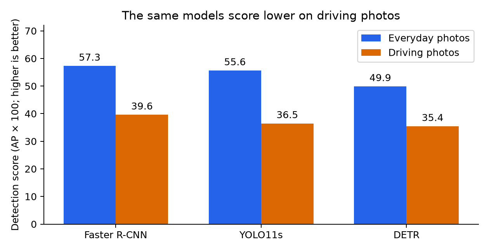
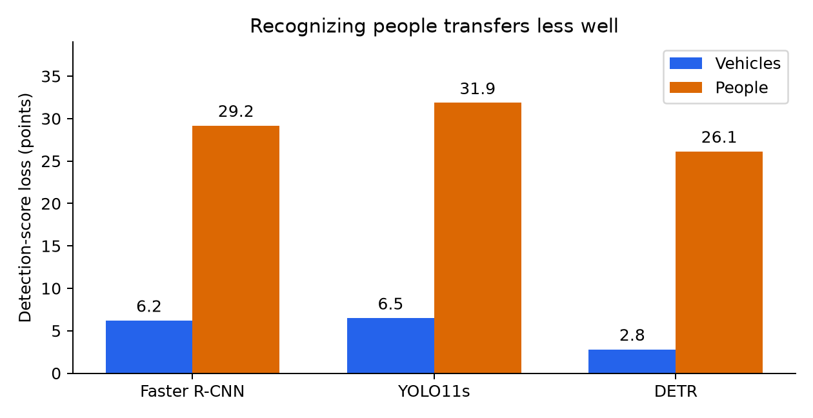

# When object-detection AI moves from everyday photos to driving scenes

Plain-language report · November 2, 2026

# Page 1: Can image-recognition AI handle a new setting?

A plain-language guide to the experiment · November 2, 2026

The question

An AI system may recognize objects well in ordinary photographs and still struggle when a camera looks out onto a road. This project tested that change of setting. It also asked a practical question: which system gives the best balance between recognition quality, processing time, and computer memory?

Three existing systems were tested: Faster R-CNN, YOLO11s, and DETR. They had already learned from a large collection of everyday photographs. They were used as supplied, without extra training on the driving photographs. The same saved experiment results support this report and the separate technical report.

What the experiment found

| Finding | What it means |
| --- | --- |
| Faster R-CNN scored highest | Best overall recognition score in these tests |
| YOLO11s was fastest | Less time and measured GPU memory per image |
| Every model lost score on driving photos | Success in one setting did not transfer fully |
| People had the larger score loss | The change of setting affected classes differently |

How much evidence is behind this?

Recognition quality was measured on 5,000 everyday photographs and 7,481 driving photographs. These are complete selected dataset splits, rather than a handful of attractive examples. Processing speed and memory were measured on a smaller sample of 100 images from each collection. Actual computer-job logs, settings, and numerical result files were saved.

The main conclusion is a tradeoff. The model with the best recognition score was not the fastest. More importantly, none of the three retained its everyday-photo score when moved to the driving collection. The results help compare these model configurations; they do not establish a universal winner for every camera, scene, or application.

How to read this report

Pages 2–3 explain the systems and the scoring in everyday terms. Pages 4–6 cover the findings and where the systems struggle. Pages 7–8 explain the checks, practical implications, and limits. Page 9 lists the research and official software sources. Technical terms are introduced where needed; the original report and code retain the detailed settings.

# Page 2: What the systems do, and what we tested

Object detection is more than naming a picture

A detector must say what an object is and draw a rectangle around where it appears. A driving image might contain several cars and pedestrians at once. A useful result needs the right label, the right number of objects, and boxes that fit them reasonably well. Calling the whole picture 'a road scene' would not solve this task.

Three ways of approaching the task

Faster R-CNN works in two main stages: propose promising regions, then examine them to classify objects and refine their boxes [1,7]. Its feature pyramid combines information at several image scales [2]. The actual version tested is called fasterrcnn_resnet50_fpn_v2. Its name identifies a particular configuration, not every possible Faster R-CNN model.

YOLO11s uses a one-stage detection approach [8]. The original YOLO research introduced predicting boxes and object classes directly from a full image [3]. YOLO11s is a newer, specific implementation in that family, released in 2024; its official documentation, rather than the original YOLO paper, describes the version tested here. The 's' identifies its small model variant.

DETR uses a transformer to predict a collection of objects and their boxes [4,9]. It considers relationships and image context. Its design learns to produce a set of predictions without the usual separate step that removes overlapping duplicate detections. This experiment used the supplied ResNet-50 version, not every model based on DETR.

Two photograph collections

| Collection | What it represents | Images checked |
| --- | --- | --- |
| COCO | Varied everyday scenes | 5,000 |
| KITTI | Images from a driving setting | 7,481 |

COCO is an established object-recognition dataset [5]. KITTI was created to test computer vision in autonomous-driving settings [6]. The models had learned from COCO before this project. Here, KITTI's labeled training images were used only for testing: no model was retrained or adjusted using them. The hidden-label KITTI test set was not used.

A move from one kind of image collection to another is often called a change of domain. It can involve different camera views, object sizes, backgrounds, and annotation rules. A lower score after that move shows weaker transfer under the chosen test, but does not by itself identify which difference caused it.

# Page 3: What does a detection score mean?

The errors the score needs to consider

A detector can miss a real object, report an object that is not there, name it incorrectly, or draw a poorly fitting box. It also gives a confidence score for each prediction. Testing must account for both the objects it finds and the false alarms it produces as predictions are ranked by confidence.

The main research measure is mean average precision, abbreviated mAP. It summarizes this ranked performance across the object categories and several requirements for box overlap. This report displays it on a 0–100 point scale: a saved mAP of 0.4694 becomes 46.94 points. Higher is better.

A score is not a percentage of objects found

A score of 46.94 does NOT mean that the system correctly recognized exactly 46.94% of the objects. It combines several aspects of performance. Likewise, a confidence of 0.9 is the model's own score, not a guarantee that the prediction has a 90% chance of being correct. These distinctions matter when reading the tables.

How closely must a box fit?

Box overlap compares the area shared by the predicted rectangle and the reference rectangle with the area covered by either one. For illustration, if they share 8,000 square pixels and together cover 12,000, the overlap score is about 0.67. That passes a 0.50 requirement but fails a stricter 0.75 requirement. This numerical example explains the rule; it is not a measured failure case.

AP50 uses the looser 0.50 overlap requirement; AP75 uses 0.75. The headline mAP averages requirements from 0.50 to 0.95. A detector that finds roughly the right region can therefore score better on AP50 than on AP75. Recall is a separate measure of how much of the labeled content can be recovered; false alarms are not summarized by recall alone [10].

Two different comparisons in this project

| Model | Everyday-photo score: all 80 categories |
| --- | --- |
| Faster R-CNN | 46.94 |
| YOLO11s | 45.51 |
| DETR | 42.01 |

The table above is the broad COCO test. For the next page's transfer comparison, both datasets are instead scored using only two matched groups: vehicles and people. Their scores can differ simply because the task changed. We compare two-group scores with two-group scores, not the 80-category table with the driving scores.

# Page 4: Finding 1: performance falls in the new setting

Figure 1. Both collections use the same two target groups: vehicles and people.

| Model | Everyday photos | Driving photos | Points lost |
| --- | --- | --- | --- |
| Faster R-CNN | 57.31 | 39.62 | 17.69 |
| YOLO11s | 55.64 | 36.48 | 19.16 |
| DETR | 49.91 | 35.45 | 14.46 |

Every model scored lower on the driving collection. Faster R-CNN still had the highest overall score, followed by YOLO11s and DETR. The loss is meaningful because the object groups are aligned, all images in the selected splits are used, and every model follows the same evaluation rules within each dataset.

A smaller drop does not automatically mean a better model

DETR lost the fewest points, but it began with a lower everyday-photo score and ended with the lowest driving-photo score. A model can have a smaller decline without being the strongest choice in the new setting. Both the starting point and the final score matter.

What we controlled, and what still changed

Both reference labels and model predictions were grouped into vehicles and people. Cars, trucks, buses, and trains in COCO were aligned with KITTI's Car, Van, Truck, and Tram labels. KITTI's Pedestrian and Person_sitting labels were grouped as people. This removes a major mismatch in category names.

The collections still differ in scene content, object mix, camera viewpoint, and how people drew the reference boxes. Some labels and ignored regions have no perfect equivalent. The score decline is evidence of weaker transfer under this test; it is not a clean measurement of visual change alone.

# Page 5: Where the models struggle

Figure 2. People lose substantially more detection-score points than vehicles.

Recognizing people was the clearest transfer weakness

Across the three models, the score for people fell by about 26–32 points. The vehicle score fell by about 3–6.5 points. This repeated pattern points to an important weakness that would be hidden by reporting only one overall score. It does not tell us the exact number of pedestrians missed.

Small objects are difficult, but that is not the whole story

| Model | Small objects | Medium objects | Large objects |
| --- | --- | --- | --- |
| Faster R-CNN | 27.2 | 37.9 | 49.9 |
| YOLO11s | 19.8 | 34.6 | 49.1 |
| DETR | 16.7 | 33.3 | 50.4 |

These driving-photo scores show the weakest results for small objects. However, medium and large objects lost more points between the two collections. Being the hardest group in the final test is different from suffering the biggest decline. The dataset rules also measure object area differently, so these size comparisons are approximate.

A roughly placed box is easier than a precise one

All models scored much better on driving photos when box overlap was judged loosely than when it was judged strictly. That suggests accurate placement deserves attention alongside recognizing the object category. The score alone cannot separate badly placed boxes from missed objects or other errors.

Different pedestrian viewpoints, partial obstruction, distant people, and labeling conventions are possible explanations for the weaknesses. They were not separately tested. Per-image predictions were not kept, so this report does not present individual failure images or claim to have counted each kind of error. This is a numerical failure analysis, with that limit made explicit.

# Page 6: Finding 2: better scores come at a cost

How long does one picture take?

A millisecond is one thousandth of a second. Lower processing time is better for speed. A graphics processor, or GPU, performs the model calculations; its memory holds model information and temporary working data. The measurements below come from a Tesla V100 with 32 GB of memory.

| Photos | Model | Average ms | 95th-percentile ms | Images / sec |
| --- | --- | --- | --- | --- |
| Everyday | Faster R-CNN | 64.16 | 68.87 | 15.6 |
| Everyday | YOLO11s | 11.79 | 38.32 | 84.8 |
| Everyday | DETR | 38.73 | 43.53 | 25.8 |
| Driving | Faster R-CNN | 53.33 | 54.66 | 18.8 |
| Driving | YOLO11s | 8.86 | 9.29 | 112.9 |
| Driving | DETR | 27.45 | 28.98 | 36.4 |

The 95th percentile describes the slower end of the sample: about 95% of measured predictions finished at or below that time. For YOLO11s on everyday photos, the average was 11.79 ms but this slower-end value was 38.32 ms. Average speed alone hides such variability. The sample cannot tell us why those slower predictions occurred.

How much GPU memory was used?

| Model | Everyday photos: MiB | Driving photos: MiB |
| --- | --- | --- |
| Faster R-CNN | 1132.9 | 1089.0 |
| YOLO11s | 110.5 | 82.8 |
| DETR | 472.0 | 321.5 |

MiB is a unit of memory, close to a megabyte. These are peak amounts actively allocated by PyTorch, the software running the models. They include the loaded model and temporary tensors, but not every byte used by the GPU or the memory needed before warmup finished. Cached memory is recorded separately in the technical results.

The practical tradeoff

On everyday photos, YOLO11s processed images about 5.4 times as fast as Faster R-CNN while giving up 1.43 points on the broad recognition score. On driving photos, it was about 6.0 times as fast with a 3.14-point score gap. It used the least measured GPU memory in both cases. Faster R-CNN offered the highest overall score; DETR sat between them in speed and memory.

Speed here means one image at a time through the prediction function. It includes image preparation and returning the boxes, but excludes reading image files from disk. It is not a measured complete video-processing rate. Differences in image size, model design, and software all contribute to the outcome.

# Page 7: How trustworthy is the comparison?

Evidence that the experiments actually ran

Two saved cluster jobs produced the measurements. Job 50149631 ran the broad everyday-photo tests and speed checks; Slurm reported successful completion. Job 50151110 ran the matched everyday/driving comparison and driving speed checks; its saved log ends with the completion message. The results include nine accuracy evaluations, six timing/memory measurements, and two full-data sanity checks.

Checking the measuring tool before trusting the models

The reference answers were fed back into the evaluator as if they were predictions. This produced the maximum overall score on both collections. That checks that many parts of the scoring pipeline fit together. It does not mean the AI models achieved a perfect score or prove that every category-mapping choice is ideal. One size-specific sanity score rounded to 99.99 rather than 100; the technical report discloses it.

Four additional small tests checked label mapping, excluded regions, images without target objects, empty model outputs, and malformed inputs. All models used the same images and the same low confidence cutoff, while their usual image resizing and duplicate-removal rules were recorded. The code follows the course tutorial's separation of models, data, and evaluation [11].

Accuracy and speed use different amounts of evidence

| Measurement | Evidence used |
| --- | --- |
| Recognition quality | All 5,000 everyday and 7,481 driving images |
| Speed and memory | 100 timed predictions per model and collection |
| Warmup | 20 untimed predictions before each speed test |
| Repeatability | Saved settings, commands, versions, IDs, and logs |

The timing code waited for the GPU to finish before stopping each timer. Without this step, it might time the act of submitting work rather than the work itself. Warmup kept some first-use setup out of the measurements. However, the first 100 sorted images may not represent the full collection, and timing was not repeated across several independent samples.

Important limits

These are three particular model versions, not equal-sized or identically trained systems. Their image resolutions differ. The GPU nodes were shared and the two jobs ran on different machines with the same GPU model. Small score differences and speed variations therefore deserve caution. The experiment has no repeated-run uncertainty estimates and does not establish performance on a different GPU, camera, or application.

# Page 8: What to take away, and how to check it

What the results support

If the priority is the highest overall recognition score among these tested configurations, Faster R-CNN leads. If processing speed and GPU memory are the main constraints, YOLO11s offers the strongest measured tradeoff. A single overall score is still insufficient: check the relevant object group, box-placement requirement, object size, and slower-end response times.

The strongest transfer finding is that people lost much more score than vehicles. That makes pedestrian-related detection a clear place for further investigation. It does not prove that a particular training method, model family, or camera change caused the loss. Testing on the intended setting remains necessary even when a system looks strong on a familiar benchmark.

The driving score has a custom set of rules

Some KITTI labels, including cyclists and regions marked 'do not care,' do not fit the chosen two-group comparison cleanly. Their boxes were retained as ignored regions rather than counted as ordinary background. Predictions overlapping those regions can be left out of scoring for either target group. This prevents some unfair penalties, but can also suppress predictions near real target objects. The effect was not measured under an alternative rule.

For this reason, the reported driving scores should not be compared directly with KITTI's official leaderboard. Both photograph collections were scored using the same COCO-style evaluation framework, with the specific adaptation explained in the code and technical report [10]. The category grouping and reference-box conventions still leave differences between the two datasets.

What to test next

Useful next steps would be to save predictions for individual images, inspect missed people and false alarms, test how ignored-region choices affect scores, and repeat speed checks on different image samples. Additional training on driving images could then be tested as a possible improvement. None of those follow-up experiments is claimed as completed here.

Where the detail lives

The companion technical_report.pdf gives the full settings, metric tables, and limitations. experiment_code_and_results.zip includes the code, commands, raw results, package versions, and job logs. The code is also in github.com/jainish1p-code/object-detection-benchmark. To rerun the original jobs, the recorded commands are: sbatch scripts/run_coco.slurm and sbatch scripts/run_domains.slurm. Those require the datasets and the documented cluster environment; the PyTorch version setup is recorded against official instructions [12].

AI assistance

Claude supplied initial notes. ChatGPT/Codex helped with coding, debugging, explanations, analysis, references, and report preparation. The user ran the cluster experiments and copied the outputs. The numbers here come from those saved outputs, not from published benchmark tables. The student remains responsible for reviewing the explanations and submission. This version changes the presentation, not the experiments or the evidence.

# Page 9: References and further reading

Research papers [1–6] explain the original ideas and datasets. Official sources [7–10,12] describe the software used; [11] is the course tutorial. You do not need to read these to follow the main findings, but they let a reader check the technical explanations. Documentation was checked November 2, 2026.

[1] S. Ren, K. He, R. Girshick, and J. Sun. Faster R-CNN: Towards Real-Time Object Detection with Region Proposal Networks. NeurIPS, 2015.

https://arxiv.org/abs/1506.01497

[2] T.-Y. Lin, P. Dollar, R. Girshick, K. He, B. Hariharan, and S. Belongie. Feature Pyramid Networks for Object Detection. CVPR, 2017.

https://arxiv.org/abs/1612.03144

[3] J. Redmon, S. Divvala, R. Girshick, and A. Farhadi. You Only Look Once: Unified, Real-Time Object Detection. CVPR, 2016.

https://arxiv.org/abs/1506.02640

[4] N. Carion, F. Massa, G. Synnaeve, N. Usunier, A. Kirillov, and S. Zagoruyko. End-to-End Object Detection with Transformers. ECCV, 2020.

https://arxiv.org/abs/2005.12872

[5] T.-Y. Lin et al. Microsoft COCO: Common Objects in Context. ECCV, 2014.

https://arxiv.org/abs/1405.0312

[6] A. Geiger, P. Lenz, and R. Urtasun. Are we ready for Autonomous Driving? The KITTI Vision Benchmark Suite. CVPR, 2012.

https://www.cvlibs.net/publications/Geiger2012CVPR.pdf

[7] PyTorch/torchvision. fasterrcnn_resnet50_fpn_v2, torchvision 0.22 model documentation. Accessed November 2, 2026.

https://docs.pytorch.org/vision/0.22/models/generated/torchvision.models.detection.fasterrcnn_resnet50_fpn_v2.html

[8] Ultralytics. YOLO11 official model documentation (model released 2024). Accessed November 2, 2026.

https://docs.ultralytics.com/models/yolo11/

[9] Hugging Face. Transformers DETR model and image-processor documentation. Accessed November 2, 2026.

https://huggingface.co/docs/transformers/model_doc/detr

[10] COCO Consortium. Official COCO API: PythonAPI/pycocotools/cocoeval.py. Accessed November 2, 2026.

https://github.com/cocodataset/cocoapi/blob/master/PythonAPI/pycocotools/cocoeval.py

[11] DeepDataMiningLearning contributors. ngdet Tutorial: Zero-shot 2D detection across datasets. Course repository. Accessed November 2, 2026.

https://github.com/lkk688/DeepDataMiningLearning/blob/main/DeepDataMiningLearning/ngdet/TUTORIAL.md

[12] PyTorch. Previous PyTorch Versions: PyTorch 2.7.1 / torchvision 0.22.1 CUDA 11.8 installation. Accessed November 2, 2026.

https://pytorch.org/get-started/previous-versions/
