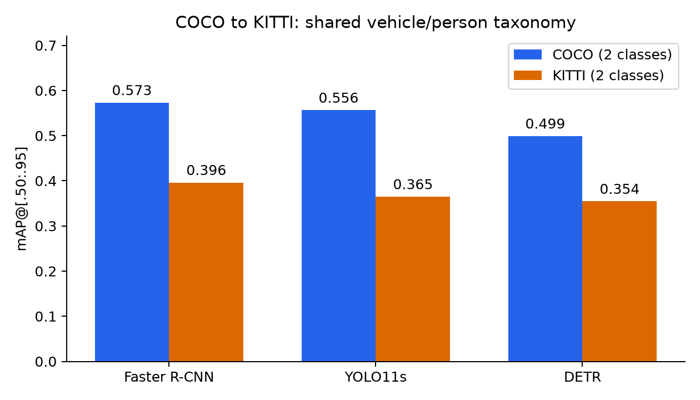
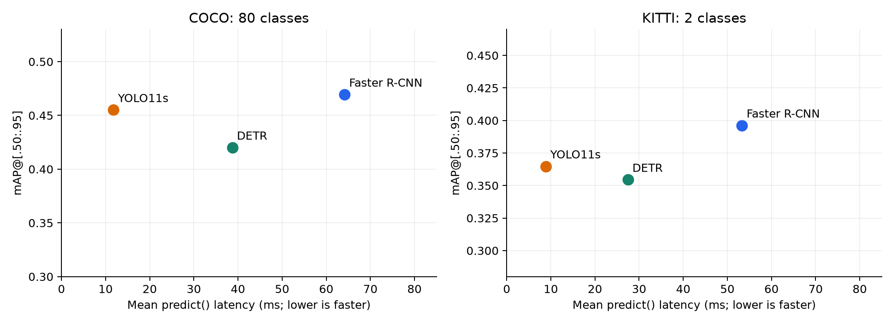

# 2D Object Detection: COCO to KITTI

Track A technical report. November 2, 2026.

# Page 1: 2D Object Detection: COCO to KITTI

Technical report · Track A · November 2, 2026

Abstract

This experiment compares three COCO-pretrained detector configurations: Faster R-CNN ResNet-50 FPN v2, YOLO11s, and DETR ResNet-50. Accuracy is evaluated on all 5,000 COCO val2017 images and all 7,481 labeled KITTI object-detection training images, without retraining. A shared vehicle/person taxonomy permits a controlled label-space comparison alongside native 80-class COCO evaluation. All measurements were produced by actual Slurm jobs on a Tesla V100 32 GB GPU, with saved JSON metrics and logs. Faster R-CNN has the highest aggregate AP; YOLO11s has the lowest latency and allocated GPU memory. Person AP degrades much more than vehicle AP on KITTI. The report analyzes transfer and efficiency while documenting annotation, ignore-region, resolution, and sampling limitations.

1. Questions and experimental design

The two primary questions are: (1) How well do COCO-pretrained detectors transfer to autonomous-driving imagery when class definitions are aligned? (2) How much accuracy is traded for lower latency and memory? Each model is evaluated with the same image set, confidence threshold, and evaluator within each task. Family-specific preprocessing and NMS defaults are recorded rather than silently equated. The course tutorial [11] motivates separating detector adapters, dataset conversion, taxonomy, and evaluation.

2. Detector families and their technical differences

Faster R-CNN shares image features between a region proposal network and a second-stage classifier/box regressor [1]. The evaluated torchvision v2 configuration uses a ResNet-50 feature pyramid [7]. FPN combines top-down features and lateral connections across scales [2]; the observed small-object results can be discussed in this context, but the experiment does not isolate FPN's causal contribution.

YOLO11s is a recent one-stage detector from Ultralytics [8]. The original YOLO paper established direct full-image box/class prediction [3]; it is cited as architectural background, not as a description of every YOLO11 layer or training loss. The actual evaluated 2024-era YOLO11 configuration is specified by its official implementation and checkpoint.

DETR predicts a set of boxes using learned object queries and a transformer encoder-decoder [4]. Bipartite matching is part of its pretraining objective; the inference path does not apply NMS. The Hugging Face adapter uses the pretrained ResNet-50 checkpoint and processor [9]. No model is fine-tuned here, and model capacity, training recipes, resolutions, and software paths differ. Findings therefore compare these three configurations, not detector families in isolation.

# Page 2: Experimental setup, datasets, and metrics

3. Models, hardware, and environment

| Configuration | Checkpoint | Resize / NMS |
| --- | --- | --- |
| Faster R-CNN | torchvision COCO_V1 | 800 / ≤1333; IoU 0.5 |
| YOLO11s | yolo11s.pt | imgsz=640; IoU 0.7 |
| DETR ResNet-50 | facebook/detr-resnet-50 | 800 / ≤1333; no NMS |

Faster R-CNN's exact model is fasterrcnn_resnet50_fpn_v2. The 800/≤1333 rule sets the target short side and limits the long side. YOLO uses aspect-preserving letterboxing with shape-dependent rectangular padding. Confidence is 0.001 for every configuration; adapters return at most 100 detections (100 queries for DETR). Defaults are recorded in the original JSONs. Native inference was used without TensorRT, explicit FP16, or fine-tuning.

PSC Bridges-2: Tesla V100-SXM2-32GB, NVIDIA driver 580.178.04, four allocated CPU cores, and four PyTorch CPU threads. Software: Python 3.11.18, torch 2.7.1+cu118, torchvision 0.22.1+cu118, CUDA build 11.8, Ultralytics 8.4.198, Transformers 5.22.1, pycocotools 2.0.11, NumPy 2.4.6. Exact package snapshots accompany both jobs. The CUDA 11.8 installation follows the official PyTorch version matrix [12].

4. Dataset selection and label alignment

COCO [5] is evaluated on all 5,000 val2017 images. KITTI [6] uses all 7,481 labeled object-detection training images exclusively for evaluation. No weights or thresholds were fitted on KITTI; the unlabeled test split is unused. Every model sees identical sorted IDs within a dataset, including images with no mapped target objects. All image/label pairs were checked before evaluation.

| Shared label | COCO GT and predictions | KITTI GT |
| --- | --- | --- |
| vehicle | car, truck, bus, train | Car, Van, Truck, Tram |
| person | person | Pedestrian, Person_sitting |

Both ground truth and predictions are mapped. KITTI has 33,261 mapped vehicles and 4,709 persons. Cyclist (1,627), Misc (973), and DontCare (11,295) boxes become COCO crowd-ignore regions for both target classes. Real ground truth has matching priority; unmatched detections can be ignored by intersection/detection-area at each overlap threshold [10]. This custom policy is an approximation, not official KITTI AP_R40. All target difficulties are retained. Native COCO-80 evaluation is preserved separately.

5. Metric definitions

AP averages interpolated precision over IoU=.50:.05:.95 and recall; AP50/AP75 fix IoU. AR1/10/100 average recall with detection caps per category/image [10]. Small, medium, and large use annotation areas split at 32² and 96² pixels. COCO retains supplied areas, normally segmentation areas; KITTI uses clipped bounding-box area. This difference limits scale comparisons. AP values are fractions in [0,1]; gaps are absolute percentage points.

# Page 3: Quantitative accuracy and recall

Table 1. Full-dataset AP. C80 = native COCO (80 classes); C2 = COCO vehicle/person; K2 = KITTI vehicle/person. All three use the same COCO-style evaluator. Native C80 scores are not used to compute cross-domain gaps.

| Set | Model | AP | AP50 | AP75 | AP-S | AP-M | AP-L |
| --- | --- | --- | --- | --- | --- | --- | --- |
| C80 | Faster R-CNN | 0.4694 | 0.6790 | 0.5136 | 0.3095 | 0.5075 | 0.6033 |
| C80 | YOLO11s | 0.4551 | 0.6197 | 0.4921 | 0.2762 | 0.5008 | 0.6247 |
| C80 | DETR | 0.4201 | 0.6225 | 0.4422 | 0.2118 | 0.4585 | 0.6104 |
| C2 | Faster R-CNN | 0.5731 | 0.8317 | 0.6279 | 0.4184 | 0.6367 | 0.7497 |
| C2 | YOLO11s | 0.5564 | 0.7762 | 0.6011 | 0.3462 | 0.6501 | 0.7987 |
| C2 | DETR | 0.4991 | 0.7633 | 0.5194 | 0.2700 | 0.5884 | 0.7745 |
| K2 | Faster R-CNN | 0.3962 | 0.7454 | 0.3828 | 0.2720 | 0.3794 | 0.4992 |
| K2 | YOLO11s | 0.3648 | 0.7007 | 0.3419 | 0.1979 | 0.3459 | 0.4915 |
| K2 | DETR | 0.3545 | 0.7026 | 0.3169 | 0.1672 | 0.3333 | 0.5041 |

Table 2. Recall over IoU=.50:.95. AR-S/M/L use maxDets=100. The lower shared-task AR1 is consistent with merging multiple vehicle categories under a single per-category detection cap; it should not be compared directly with native AR1 as if the tasks were identical.

| Set | Model | AR1 | AR10 | AR100 | AR-S | AR-M | AR-L |
| --- | --- | --- | --- | --- | --- | --- | --- |
| C80 | Faster R-CNN | 0.3698 | 0.5955 | 0.6298 | 0.4729 | 0.6652 | 0.7736 |
| C80 | YOLO11s | 0.3474 | 0.5628 | 0.6023 | 0.4015 | 0.6586 | 0.7680 |
| C80 | DETR | 0.3333 | 0.5315 | 0.5692 | 0.3152 | 0.6228 | 0.7937 |
| C2 | Faster R-CNN | 0.2119 | 0.6056 | 0.6868 | 0.5586 | 0.7493 | 0.8375 |
| C2 | YOLO11s | 0.2144 | 0.5843 | 0.6634 | 0.4830 | 0.7578 | 0.8678 |
| C2 | DETR | 0.2063 | 0.5420 | 0.6113 | 0.3899 | 0.7114 | 0.8823 |
| K2 | Faster R-CNN | 0.1608 | 0.4681 | 0.5265 | 0.4906 | 0.5168 | 0.5791 |
| K2 | YOLO11s | 0.1531 | 0.4303 | 0.4763 | 0.3660 | 0.4750 | 0.5618 |
| K2 | DETR | 0.1479 | 0.4150 | 0.4587 | 0.3300 | 0.4506 | 0.5659 |

Faster R-CNN has the highest aggregate AP in all three tasks. YOLO11s exceeds DETR's aggregate AP, but this does not hold for every class, scale, or overlap threshold. DETR has slightly higher KITTI AP50 than YOLO11s and the highest KITTI large-object AP. Small numerical differences have not been tested for statistical significance.

All 80 native COCO per-class AP values are included in results/summary/coco_per_class.md and per_class_ap.csv. Shared-class AP is reported on page 4. Raw JSONs preserve all 12 aggregate metrics, selected image IDs, checkpoint settings, and exact commands; the supporting archive contains them rather than relying on copied tables alone.

# Page 4: Analysis I: cross-dataset generalization

Figure 1. Shared-class AP on full COCO and KITTI; both sides use vehicle/person.

| Model | COCO-2 AP | KITTI-2 AP | Drop (pp) |
| --- | --- | --- | --- |
| Faster R-CNN | 0.5731 | 0.3962 | 17.69 |
| YOLO11s | 0.5564 | 0.3648 | 19.16 |
| DETR | 0.4991 | 0.3545 | 14.46 |

| Model | COCO veh. | KITTI veh. | COCO person | KITTI person |
| --- | --- | --- | --- | --- |
| Faster R-CNN | 0.5500 | 0.4880 | 0.5962 | 0.3044 |
| YOLO11s | 0.5266 | 0.4618 | 0.5863 | 0.2678 |
| DETR | 0.4701 | 0.4421 | 0.5282 | 0.2669 |

All three models transfer less effectively to KITTI under this protocol. YOLO11s has the largest aggregate drop (19.16 points); DETR has the smallest (14.46), but its KITTI AP is still the lowest. Transfer gap alone is not a sufficient selection criterion: a weaker source-domain baseline can also have a smaller absolute gap.

Person AP falls by 29.18 points for Faster R-CNN, 31.85 for YOLO11s, and 26.13 for DETR. Vehicle AP falls by only 6.20, 6.48, and 2.80 points, respectively. The consistent class-specific pattern is stronger evidence than a single pooled AP change. It identifies pedestrian-related detection as the most important transfer weakness in this experiment.

The label-space control does not isolate visual domain shift completely. COCO's person annotations, KITTI's pedestrian/sitting-person definitions, merged vehicle categories, ignored cyclists, object distributions, and annotation geometry differ. Viewpoint, occlusion, and smaller distant pedestrians are plausible mechanisms, not measured causal explanations. No retraining was performed to test whether adaptation removes these deficits.

# Page 5: Failure analysis: scales and localization

6. Quantitative failure symptoms

Failure analysis uses measured class, scale, and overlap-threshold behavior. Per-image predictions were not retained, so false-positive/negative counts and qualitative examples cannot be reconstructed from these artifacts. Aggregate AP and AR can reveal weaknesses but cannot uniquely distinguish missed objects, misclassification, duplicate boxes, and localization errors.

| Model | Small drop (pp) | Medium drop (pp) | Large drop (pp) |
| --- | --- | --- | --- |
| Faster R-CNN | 14.64 | 25.73 | 25.05 |
| YOLO11s | 14.83 | 30.42 | 30.72 |
| DETR | 10.28 | 25.51 | 27.04 |

Medium/large objects have larger absolute cross-domain AP losses than small objects for every model. Small-object KITTI AP is nevertheless lowest within each model: 0.2720, 0.1979, and 0.1672. These are different observations: difficult small objects do not necessarily have the greatest absolute transfer loss. COCO segmentation-area bins and KITTI box-area bins are imperfectly comparable, and scale-specific class composition can change.

| Model | KITTI AP50 | KITTI AP75 | Gap (pp) | AR100 |
| --- | --- | --- | --- | --- |
| Faster R-CNN | 0.7454 | 0.3828 | 36.26 | 0.5265 |
| YOLO11s | 0.7007 | 0.3419 | 35.88 | 0.4763 |
| DETR | 0.7026 | 0.3169 | 38.57 | 0.4587 |

The large AP50-to-AP75 gaps on KITTI show that accepting roughly overlapping boxes is much easier than requiring tighter overlap. AP75 declines more than AP50 from shared COCO to KITTI for every model. This is consistent with a localization-sensitive weakness, but changes in box conventions and ranked prediction quality can also contribute. KITTI AR100 remains below 0.53, showing incomplete recall averaged across overlap thresholds; it is not a literal percentage of objects missed at one threshold.

7. Pipeline checks and known evaluator limitations

Full ground-truth-as-prediction sanity runs give aggregate AP and both class APs of 1.0000 on COCO and KITTI. KITTI medium-area AP rounds to 0.9999, which is disclosed rather than presented as exactly perfect at every submetric. Four synthetic tests cover shared-label mapping, negative images, crowd-ignore behavior, zero predictions, and malformed inputs. These validate mechanics, not the suitability of the experimental taxonomy.

Duplicating Cyclist/Misc/DontCare boxes as ignore regions for both classes can suppress detections that overlap those regions, including real target objects. Its effect was not ablated. Official KITTI difficulty filtering and AP_R40 are not used. A stronger follow-up would retain per-image predictions, inspect false positives and missed pedestrians, separate truncation/occlusion strata, and repeat evaluation under alternate ignore policies.

# Page 6: Analysis II: speed, accuracy, and memory

Figure 2. Accuracy/latency tradeoff; COCO uses 80 classes and KITTI uses two, in separate panels.

| Set | Model | Mean ms | p50 ms | p95 ms | FPS | Alloc MiB | Res MiB |
| --- | --- | --- | --- | --- | --- | --- | --- |
| COCO | Faster R-CNN | 64.16 | 64.01 | 68.87 | 15.59 | 1132.9 | 2184 |
| COCO | YOLO11s | 11.79 | 9.97 | 38.32 | 84.82 | 110.5 | 132 |
| COCO | DETR | 38.73 | 39.42 | 43.53 | 25.82 | 472.0 | 764 |
| KITTI | Faster R-CNN | 53.33 | 53.15 | 54.66 | 18.75 | 1089.0 | 2028 |
| KITTI | YOLO11s | 8.86 | 8.81 | 9.29 | 112.92 | 82.8 | 100 |
| KITTI | DETR | 27.45 | 27.21 | 28.98 | 36.43 | 321.5 | 356 |

Each independent model process performs 20 warmup predictions, then 100 timed predictions on the first 100 sorted images, batch size 1. CUDA synchronization brackets each predict() call. Timing includes preprocessing, GPU transfers, inference, postprocessing, and CPU Python outputs; disk reads, decoding, loading, and warmup are excluded. FPS = 1000/mean-ms is serial predict() throughput, not a complete application pipeline rate.

Peak allocated memory includes resident weights and live inference tensors. Reserved memory includes the PyTorch allocator cache; both peaks are reset after warmup. Non-PyTorch allocations are excluded. These are not whole-device nvidia-smi values or activation-only measurements.

YOLO11s has 5.44× Faster R-CNN's COCO FPS at a 1.43-point native-COCO AP cost, and 6.02× its KITTI FPS at a 3.14-point KITTI AP cost. Its allocated GPU memory is also lowest. Faster R-CNN supplies higher aggregate accuracy; DETR has lower aggregate accuracy and higher latency than YOLO11s in these configurations. This is an observed configuration tradeoff, not proof that one family always dominates.

YOLO11s COCO p95 is 38.32 ms versus p50 9.97 ms, exposing tail variability hidden by average FPS. One timing pass cannot establish the cause. All models are faster on the KITTI timing sample; aspect ratios, resized shapes, scene content, and backend work can vary. No repeated-run intervals, GPU power/clock controls, or timing-sample representativeness analysis were performed.

# Page 7: Reproduction and evidence of execution

8. Actual runs and supporting artifacts

| Job | Compute node | Recorded scope / outcome |
| --- | --- | --- |
| 50149631 | v003 / V100 | Native COCO + benchmarks; exit 0:0 |
| 50151110 | v020 / V100 | COCO/KITTI shared task; completion log |

Native job 50149631 completed in 00:15:25 according to the recorded Slurm status. Domain log 50151110 spans 18:13:07–18:53:44 EST on November 2 and ends with the script's completion marker. All 9 evaluation JSONs, 6 benchmark JSONs, 2 sanity JSONs, package snapshots, and both logs were copied from Ocean to the local project. Results are measured outputs, not numbers transcribed from model documentation.

9. Code paths and commands

src/detectors.py implements the three adapters; taxonomy.py aligns label names; prepare_kitti.py validates and converts labels. eval_coco.py computes metrics, records image IDs/settings, and saves per-class AP. benchmark.py measures synchronized latency and memory. scripts/run_coco.slurm and run_domains.slurm request one GPU and create job-specific output directories. Every major saved JSON records its original exact command and working directory.

From the cluster repository root, submit the original configurations:

sbatch scripts/run_coco.slurm

sbatch scripts/run_domains.slurm

An exact recorded KITTI evaluation command (display-wrapped; one shell command):

/ocean/projects/cis260281p/jpatel17/envs/det/bin/python src/eval_coco.py --model frcnn --device cuda --score-thr 0.001 --ann data/kitti/annotations/vehicle_person_train.json --img-dir data/kitti/training/image_2 --taxonomy vehicle_person --out results/domains/50151110/kitti_frcnn_eval.json

The original commands preserve account-specific Python and output paths. Re-running the batch scripts generates new job-ID directories. Installation uses torch 2.7.1 / torchvision 0.22.1 from the cu118 index [12] followed by requirements.txt; the two saved packages.txt files define the observed full environment more precisely than unpinned dependency resolution.

10. How to inspect the submitted evidence

The companion experiment_code_and_results.zip contains executable source and Slurm configurations, raw metrics with image IDs, package snapshots, logs, exported CSVs, figures, references, and exact commands. Dataset images, downloaded weights, and results/smoke are excluded. The SHA-256 manifest identifies the raw report inputs; it is not an independent timestamp or proof of model training provenance.

Start with README.md and results/summary/commands.md. Native backups are in results/50149631/ and shared-domain backups in results/50151110/. accuracy.csv contains all AP/AR statistics; per_class_ap.csv and coco_per_class.md contain all 80 native classes plus shared-class results. benchmarks.csv preserves timing and allocated/reserved memory. No dataset images are needed to regenerate the report from these artifacts.

Regenerate tables/plots: python scripts/make_report.py. Regenerate this PDF and archive: python scripts/build_submission.py. Validate synthetic evaluator behavior: python -m unittest discover -s scripts -p 'test_*.py'. The report generator also checks counts/IDs, metadata, sanity results, and timing summaries against raw samples.

# Page 8: Conclusions, limitations, and AI assistance

11. Conclusions supported by the experiment

First, matching a shared taxonomy makes a cross-dataset experiment more interpretable than subtracting 80-class COCO AP from two-class KITTI AP. With this control, every model loses AP, and person AP declines much more than vehicle AP. The model ranking remains Faster R-CNN, YOLO11s, DETR by aggregate AP. A smaller transfer gap does not compensate for a lower target-domain score.

Second, accuracy and deployment cost favor different configurations. Faster R-CNN offers the strongest aggregate accuracy, while YOLO11s offers the best measured latency and memory. The practical choice depends on application constraints, including tail latency. DETR is neither the fastest nor the most accurate here; its conceptual simplification of prediction [4] does not imply a speed win for this checkpoint and software path.

Third, the failure analysis distinguishes class, scale, and localization symptoms. People transfer worse than vehicles; small KITTI objects are hardest within each model, but medium/large bins have larger absolute cross-domain AP losses. The AP75 decline motivates checking box alignment and localization quality rather than attributing every loss to class recognition. These are descriptive, testable findings rather than causal claims.

12. Threats to validity and useful next experiments

The models differ in training recipes, parameter counts, input sizes, and backend implementations. Results compare complete configurations. COCO and KITTI differ in visual content, class/object distributions, annotation conventions, and area definitions. Merged labels and crowd-ignore handling can affect rankings. The experiment measures no sensitivity to alternate ignore policies, thresholds, label mappings, or input resolutions.

Latency comes from one 100-image pass per model/dataset rather than repeated trials. The first sorted images may not be representative. GPU-shared nodes and different compute hosts can introduce load variability. CUDA synchronization and warmup prevent basic timing errors but do not establish confidence intervals. Peak memory excludes non-PyTorch allocations and initialization peaks before the reset.

Checkpoint identifiers and framework versions are recorded, but immutable downloaded-weight hashes and a specific Hugging Face checkpoint revision were not. Pretraining provenance was not audited for overlap beyond the named COCO-pretrained weights. No training is performed here; using KITTI's labeled training split is an evaluation protocol choice, not a fine-tuning experiment or official leaderboard submission.

Prioritized follow-ups are: preserve per-image predictions for visual/error-stratified audits; repeat latency on randomized samples with clock/load metadata; ablate ignore-region treatment and area definitions; then evaluate fine-tuning or a newer detector under the same protocol. These were not run and are not included as measured results.

13. AI tool usage and verification

Claude supplied initial handoff notes. ChatGPT/Codex assisted with experiment planning, environment debugging, benchmark/evaluation/conversion scripts, reference discovery, analysis, report generation, and packaging. The user ran the actual cluster commands and copied the experiment outputs. Report numbers are computed from those outputs; code tests and full-dataset sanity checks validate parts of the pipeline. Architectural explanations were checked against original papers and official sources cited here. The student remains responsible for reviewing the generated code, explanations, and final submission; AI assistance does not replace that review.

# Page 9: References

Six original research papers [1–6], five official repository/framework sources [7–10,12], and the course tutorial [11]. Foundational papers provide background; current YOLO11 details are attributed to the official model documentation. Web documentation accessed November 2, 2026.

[1] S. Ren, K. He, R. Girshick, and J. Sun. Faster R-CNN: Towards Real-Time Object Detection with Region Proposal Networks. NeurIPS, 2015.

https://arxiv.org/abs/1506.01497

[2] T.-Y. Lin, P. Dollar, R. Girshick, K. He, B. Hariharan, and S. Belongie. Feature Pyramid Networks for Object Detection. CVPR, 2017.

https://arxiv.org/abs/1612.03144

[3] J. Redmon, S. Divvala, R. Girshick, and A. Farhadi. You Only Look Once: Unified, Real-Time Object Detection. CVPR, 2016.

https://arxiv.org/abs/1506.02640

[4] N. Carion, F. Massa, G. Synnaeve, N. Usunier, A. Kirillov, and S. Zagoruyko. End-to-End Object Detection with Transformers. ECCV, 2020.

https://arxiv.org/abs/2005.12872

[5] T.-Y. Lin et al. Microsoft COCO: Common Objects in Context. ECCV, 2014.

https://arxiv.org/abs/1405.0312

[6] A. Geiger, P. Lenz, and R. Urtasun. Are we ready for Autonomous Driving? The KITTI Vision Benchmark Suite. CVPR, 2012.

https://www.cvlibs.net/publications/Geiger2012CVPR.pdf

[7] PyTorch/torchvision. fasterrcnn_resnet50_fpn_v2, torchvision 0.22 model documentation. Accessed November 2, 2026.

https://docs.pytorch.org/vision/0.22/models/generated/torchvision.models.detection.fasterrcnn_resnet50_fpn_v2.html

[8] Ultralytics. YOLO11 official model documentation (model released 2024). Accessed November 2, 2026.

https://docs.ultralytics.com/models/yolo11/

[9] Hugging Face. Transformers DETR model and image-processor documentation. Accessed November 2, 2026.

https://huggingface.co/docs/transformers/model_doc/detr

[10] COCO Consortium. Official COCO API: PythonAPI/pycocotools/cocoeval.py. Accessed November 2, 2026.

https://github.com/cocodataset/cocoapi/blob/master/PythonAPI/pycocotools/cocoeval.py

[11] DeepDataMiningLearning contributors. ngdet Tutorial: Zero-shot 2D detection across datasets. Course repository. Accessed November 2, 2026.

https://github.com/lkk688/DeepDataMiningLearning/blob/main/DeepDataMiningLearning/ngdet/TUTORIAL.md

[12] PyTorch. Previous PyTorch Versions: PyTorch 2.7.1 / torchvision 0.22.1 CUDA 11.8 installation. Accessed November 2, 2026.

https://pytorch.org/get-started/previous-versions/
